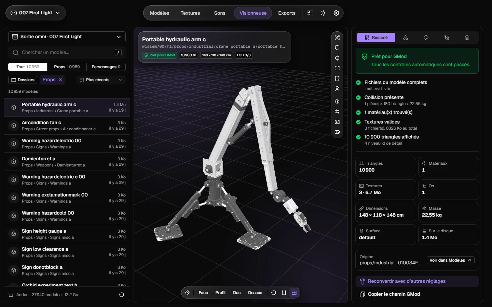
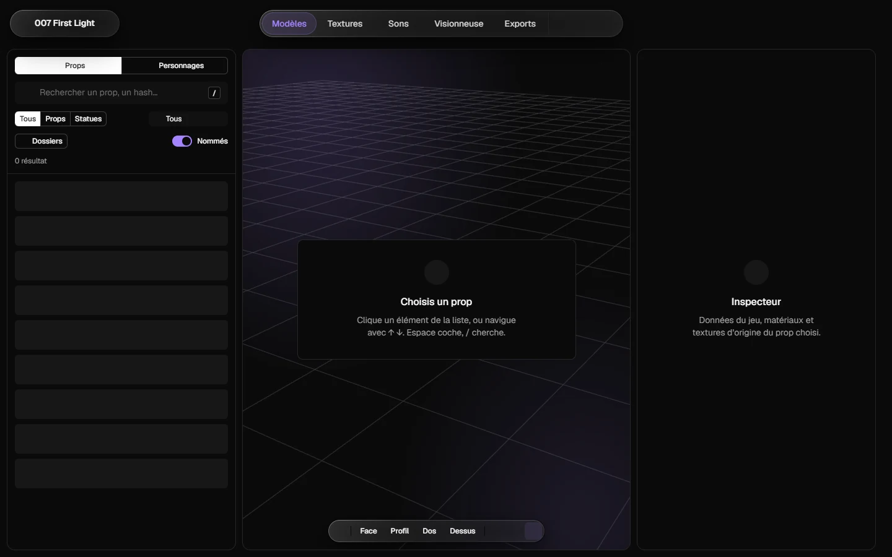
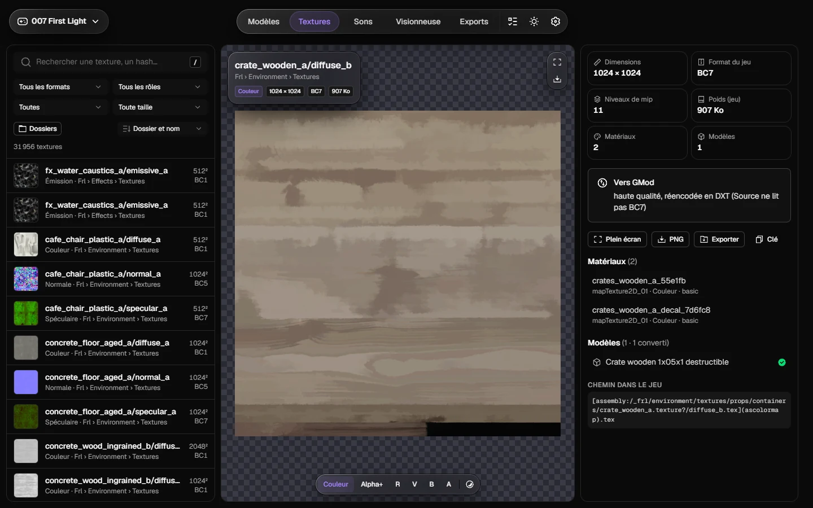

# omni

Converts the assets of a game into Garry's Mod content and glTF models, locally, on Windows.

[](https://ci.wissem.pro/repos/19)
[](https://github.com/WissemBad/omni/releases)
[](LICENSE)


omni reads the files of **your own copy** of a game and writes a ready-to-use Garry's Mod addon (props, player models, textures), glTF models for Blender and the game's sounds. Nothing is uploaded and no game file is shipped.

Supported: *007 First Light* and *HITMAN World of Assassination* (Glacier engine) and Unreal Engine 5 games. You only give omni the game's folder: it identifies the engine and fetches what else it needs.

The parsers, texture codecs, audio converters, glTF writer and bulk readers are a Rust core; Python orchestrates the jobs and serves the interface (Nuxt 4, Nuxt UI 4 and [Wissem UI](https://github.com/Wissem-Industries/ui)) in the system's WebView2 window.



## What it does

- **Props and player models**: each model becomes a complete Source model (`.mdl` with materials, collision and levels of detail), written into one addon linked to Garry's Mod. Characters become player models, their variations becoming bodygroups and skins.
- **Viewer**: shows a model the way Garry's Mod loads it, with skeleton, hitboxes, collision and animations, and checks that its files are complete. It needs no game: open any `.mdl`, a Workshop `.gma` or an installed addon (`Omni.exe view <path>`).
- **Textures**: every texture of the game with its role and format, previewed per channel, exported to PNG or converted to VTF.
- **Sounds**: the game's audio exported into a named folder tree (voices by language and conversation, effects by event), without duplicates, with tags and an index.
- **Selection**: a separate addon holding only the models listed in a text file.
- **glTF and Blender**: one `.glb` per model, and `.blend` files when Blender is installed.

Long jobs wait in a queue and run one at a time; a whole-game export can be cancelled and resumes where it stopped.

| Models | Textures |
| --- | --- |
|  |  |

The interface is in French.

## Install

Download `Omni-Setup-<version>.exe` (installer) or `Omni-<version>-windows.zip` (portable) from the [releases](https://github.com/WissemBad/omni/releases), start Omni, then add a game on the **Jeux** page. `SHA256SUMS.txt` lists the checksums of both files. A short guide in French is in [docs/mode-emploi.md](docs/mode-emploi.md).

Requirements: Windows 10 or 11 with the WebView2 runtime, a copy of the game, Garry's Mod for the model conversion.

## Where files go

Omni keeps everything it writes in one folder, `Documents\Omni` by default (`omni home set <folder>` or the settings move it):

| Folder | Content |
| --- | --- |
| `exports\<game>\` | What you take away: `garrysmod-addon`, `gltf`, `sounds`, `textures`, `blend`, the `.gma` archive |
| `workspace\` | What omni manages (settings, catalogs, caches, tools, logs). Safe to ignore |

The application itself holds no data. An older data folder is moved into the new layout on first start (`omni migrate <old folder>` for a custom location).

## Development

Requirements: [uv](https://docs.astral.sh/uv/), [Bun](https://bun.sh), Rust (rustup) and a token with `read:packages` in your user `.npmrc` for `@wissem-industries/ui`.

```powershell
uv sync --inexact                        # --inexact keeps the Rust core that is installed next
uv run --no-sync python -m omni native --build     # Rust core
cd web; bun install; bun run build; cd ..
.\Omni.cmd                               # or: uv run --no-sync python -m omni app
```

Checks, the same as CI:

```powershell
.\scripts\check.ps1          # ruff, import contracts, pyright (ratchet), versions, pytest + coverage, cargo fmt/clippy/test/deny, web
.\scripts\check.ps1 -Fast    # without the web build and the Rust tests
```

The tests run in a throwaway Omni folder on a synthetic game (`tests/synthetic.py`), so no game file is needed. Point `OMNI_HOME` at a throwaway folder when you run a command that writes exports.

Package locally with `uv run --no-sync pyinstaller packaging/omni.spec --noconfirm`, then compile `packaging/omni.iss` with Inno Setup.

## Release

Versions follow Semantic Versioning and changes are listed in [CHANGELOG.md](CHANGELOG.md). CI (Woodpecker, Linux) runs the checks on every pull request; the Windows installer is built on a Windows machine with [scripts/build_release.ps1](scripts/build_release.ps1).

```powershell
uv run --no-sync python scripts/release.py <x.y.z>      # version bump, in a chore(release) pull request
git tag -a vX.Y.Z -m vX.Y.Z; git push origin vX.Y.Z    # once that pull request is merged
.\scripts\build_release.ps1 <x.y.z> -Publish           # installer, archive, checksums and the GitHub release
```

It needs the tools listed at the top of the script (Bun, Rust with the MSVC toolchain, Inno Setup 6, the GitHub CLI) and `OMNI_RELEASE_KEY`, the path of the release signing key (`scripts/release_sign.py`): the updater refuses unsigned releases.

## Contributing

See [CONTRIBUTING.md](CONTRIBUTING.md). Report vulnerabilities privately as described in [SECURITY.md](SECURITY.md).

## License

[MIT](LICENSE). omni contains no asset of any game; *007 First Light*, *Garry's Mod* and the other names belong to their owners and omni is not affiliated with them.
